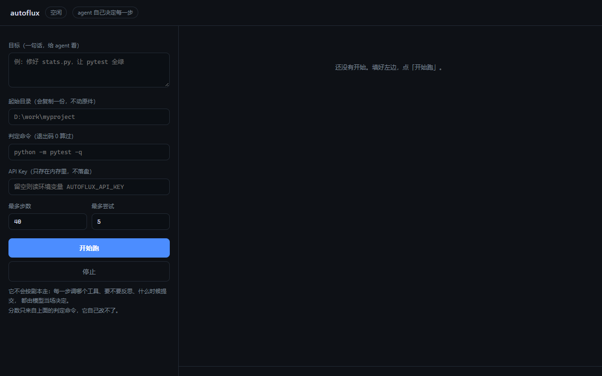
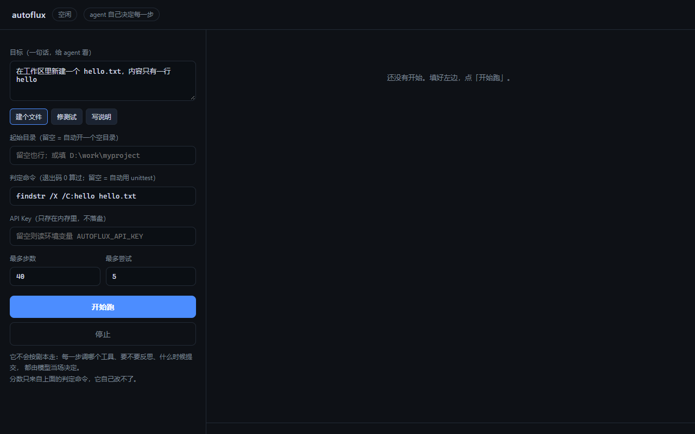
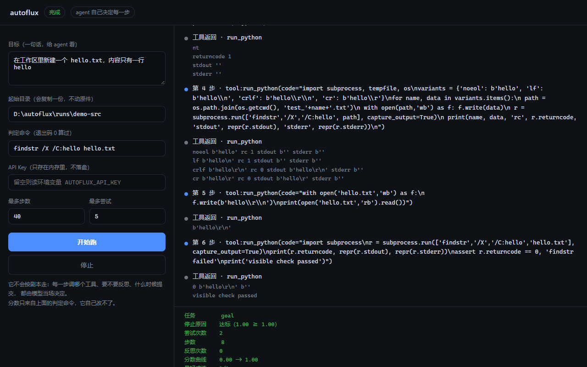
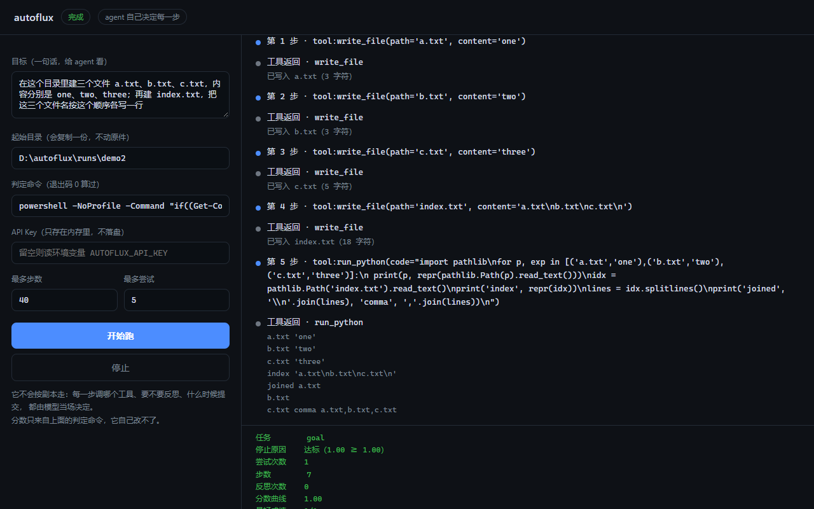

# autoflux

[](https://github.com/devhub2026-beep/autoflux/actions/workflows/tests.yml)

给它一句话目标，它自己拆、自己试、自己知道错在哪、自己改，跑到过了为止。
中间不用你管，也没有「第几步该干什么」的剧本。



---

## 一句话说清它是什么

- 你给三样东西：**目标**、**起始目录**、**判定命令**（退出码 0 算过）。
- 它把目录复制一份当工作区，然后自己决定每一步：读文件、写文件、跑代码、跑测试、
  给自己写计划、要求反思、提交评测、或者放弃。
- 分数只来自你那条判定命令，模型改不了、也蒙不了。
- 没过就继续，过了就停。

不是工作流：**没有阶段序列**。谁决定下一步，是这条线的分界——
调度算法决定的是工作流，模型看着当前情况决定的是 agent。

---

## 快速开始

### 1. 网页版（推荐）

```bash
python run.py serve
# autoflux  →  http://127.0.0.1:8765
```

浏览器打开，左边填：

| 框 | 填什么 | 例子 |
|---|---|---|
| 目标 | 一句话，给 agent 看的 | 在工作区里新建 hello.txt，内容只有一行 hello |
| 起始目录 | 留空 = 自动开一个空目录；填了就**复制**一份，原件不动 | `D:\work\myproject` |
| 判定命令 | 留空 = 自动用 unittest（只对有测试的目录有效） | `python -m pytest -q` |
| API Key | 只存在内存里，不落盘 | 留空则读环境变量 |

三个预设按钮（建个文件 / 修测试 / 写说明）会把目标和判定命令一起填好，你只需要点「开始跑」。



左栏底部还有两块：**历史**——`runs/` 里跑过的记录（重启之后也还在），点一条回放当时的轨迹；
**问数据**——拿就业工资表问答，可以连续追问，答案里每个数字都会被核对（见下文「编了数会被打回」）。

点「开始跑」，右边就是实时时间线：每一步它看了什么、调了什么、评测给了几分。



上图的真实结果：**2 次尝试、8 步、反思 0 次、曲线 0.00 → 1.00**。
第一次提交失败（`findstr /X` 在只有 LF 的文本上不匹配），它自己写代码试了四种换行，
发现要 CRLF，改完再提交，过了。这段不是剧本——那一轮它本来不在计划里。

### 2. 命令行

```bash
export AUTOFLUX_API_KEY=sk-...        # PowerShell: $env:AUTOFLUX_API_KEY="sk-..."

# 目标模式：随便一个目录 + 一条判定命令
python run.py --goal "让 python -m pytest -q 通过" --project . --check "python -m pytest -q"

# 内置任务（内置评测器，隐藏测试在仓库里）
python run.py run --task bugfix

# 从上次的断点接着跑（优先读 runs/<id>/checkpoints.sqlite，没有才退回 state.json）
python run.py run --resume runs/20261114-211337-3bb38b

# 同一批任务跑 N 次，出成功率 / 步数 / 耗时
python run.py bench --tasks all --repeats 3 --max-steps 30

# 加一个总时间预算（默认 30 分钟，0 = 不限）
python run.py run --goal "..." --project . --check "..." --max-seconds 600

# 问数据：答案里的数字要过校验，编了自动打回重写
python run.py ask --question "哪个行业工资最高？和最低差几倍？"

# 多轮问答：上一轮问答会进下一轮的上下文，空行结束
python run.py ask --chat
```

不带子命令时默认就是 `run`，所以在 PyCharm 里对着 `run.py` 点绿三角也能跑起来。

---

## 怎么装

需要 **Python 3.11+**，以及三个包：`fastapi`、`uvicorn`、`langgraph`。

```bash
pip install -e .            # 或者，装不上依赖时：pip install -e . --no-deps
```

不想装也行：`python run.py` 会把 `src/` 塞进 `sys.path`，直接用。

不想装 Python 包也行——有 Dockerfile：

```bash
docker build -t autoflux .
docker run -e AUTOFLUX_API_KEY=sk-... -p 8765:8765 autoflux
```

这个镜像每次 push 都会在 CI 里**真的建一遍**：建完在容器里跑 `autoflux --help`、`autoflux tasks`，
再起 `serve` 打 `/api/health` 和 `/api/runs`（workflow 里的 `docker` job）。
不是「我读完 Dockerfile 觉得没问题」。

模型 key 也可以放在项目根的 `.env` 里（`AUTOFLUX_API_KEY=sk-...`），启动时自动读；
`.env` 已在 `.gitignore` 里，照 `.env.example` 抄一行就行。

PyCharm 里记得把解释器指到一个**装了上面三个包**的环境，
否则 `run.py serve` 会报表 `No module named fastapi`。

---

## 三个硬规矩

### 1. 分数不来自模型

判定只有一个来源：你的判定命令，或者任务自带的评测器（`evaluator.py`：
复制工作区 → 注入隐藏测试 → 子进程跑 → 解析结果 → 得出 `Score`）。

模型看到的工作区里没有隐藏测试，也改不了评测代码。

> 这是整套东西的地基。不可执行的「我觉得做对了」，循环几代就会开始自我欺骗：
> 分数一路涨，东西一路烂。

### 2. 没有信号，不准反思

没评测过就想反思？引擎直接跳过，并在时间线里留一条 `反思 · 跳过（还没有评测信号）`。

让它反思自己的产出、又不给任何客观依据，它只会稳定地得出「我写得挺好，是要求太高了」。

### 3. 反思必须买到东西

这条是实测逼出来的。第一版跑 `bugfix`（评测把失败用例名直接甩给它），模型 22 步做完，
**反思 0 次**——失败信息已经把答案写在脸上了，反思产生不了信息。

于是加了盲测变体：只回 `8/10`，不说哪两个错；同时 `reflect` 会去调 `diagnose()`，
把失败日志捞出来给你。

```
step 8  submit      => 8/10          （只知道有 2 个没过）
step 9  reflect     ~~ 买到诊断：
                       FAIL: test_stdev_is_sample_not_population
step 10 write_file  （直接改这两处）
step 12 submit      => 10/10
```

结论：**反思要有人付钱。** 花一步，换一份日志。

---

## 它是怎么跑的

一个环，LangGraph 画的：

```
START → guard ─┬─ 停 ──────────────→ END
               └─ decide ─┬─ tool ────→ act ────┐
                          ├─ plan ────→ plan ───┤
                          ├─ reflect ─→ reflect ─┤
                          ├─ submit ──→ judge ───┤
                          └─ stop ───────────────┴─→ guard
```

- `guard`：预算/达标/外部停止，该停就停。
- `decide`：把观测交给模型，它当场选一个动作。**出边走哪条，由它这一步选的动作决定。**
- `act` / `plan` / `reflect` / `judge`：执行，然后回到 `guard`。

因为没有「先规划、再执行、再总结」的固定链，所以它是环，不是流水线。
`plan` 也只是一个可选动作：想写就写、想改就改、一次不写也能跑完。

**「自己拆」是怎么做的**：`plan` 让模型交一份子目标清单，清单会存进状态、
每一步都摆在它眼前（带 `[x]`/`[ ]`），它自己决定什么时候划掉、什么时候整个重写。
不是引擎替它拆的。



上图是另一轮真跑：目标「建 a/b/c 三个文件再写 index.txt」，它**第 0 步就先写了一份 5 项计划**，
然后一项一项做完，1 次提交 1.00，7 步。中间没有我编的步骤表。

每个状态都会写 `runs/<id>/state.json`，事件写 `runs/<id>/trace.jsonl`，
另外每一步都进 `runs/<id>/checkpoints.sqlite`（自己写的 `SqliteSaver`，LangGraph 的
checkpointer 接口）。所以进程中途死掉，`--resume runs/<id>` 是真从那个 checkpoint 接着走，
不是把整轮重放一遍。

### 卡住了它自己会被提醒

引擎会算三条客观计数，写进观察里的「【提醒】」：

- 同一个动作连做 3 步（大概在原地打转）；
- 连续 8 步没有新的评测结果（在盲改）；
- 走了 6 步还没写过计划。

它有权无视。但「我卡住了」这件事不再需要它自己悟。

---

## 反思存在哪：Skillbook

反思不是写进上下文就完事——下一轮就没了。它进 sqlite：

```
[1] 用0 赢1  评测 7/10（70%）…
    规则：改动前先把失败用例最小复现出来，确认边界输入（空、单元素、乱序）的行为。
```

下一轮、下一次运行、下一个任务，这条规则还在。网页右上角的 `/api/skills` 能看全部。

但库不能只进不出——攒到几百条以后，每轮都要把这些话塞进提示词，越反思越笨。
所以每次反思后自动淘汰两类：**反复用过、一次都没赢、且一个月没动静**的（试了也不管用），
以及**总量超过 200 条**时按「赢过 > 用过 > 新」留下的尾部。从没上过场的新规则不按第一条删，
它只是还没轮到。

---

## 目标模式是怎么判分的

`GoalTask` 只做三件事：

1. 把起始目录复制成工作区（复制时跳过 `.git`/`.venv`/`__pycache__`/`runs` 等）；
2. 提交时在工作区执行你的判定命令，**退出码 0 → 满分**；
3. 反思时把命令的尾部输出交出来（最多 4000 字符）。

判定命令如果是 unittest/pytest 那种会打印 `Ran 7 tests` 的，失败时也给**部分分**：
`FAILED (failures=2)` → `5/7`。所以它在「3 个里改对 2 个」的时候能看见自己在涨，
而不是一路 0 分到结束。

所以「什么叫对」这件事，完全在你手里——写一条能自动判的命令就行。

---

## 编了数会被打回：就业示例

`examples/employment/` 是同一套规矩换到「写字」上：读国家统计局的工资表，
写一份经得起核对的报告。这里有两道闸，都不经过模型自评。

**第一道：报告闸。** `_check.py` 在工作区外面（工作区只复制 `data/`），
查数字对不对、19 个行业点没点全、倍数算没算。它自己也有自检：
`python examples/employment/tools/selfcheck.py` 用一份标准答案报告反查判分脚本。

**第二道：问答闸。** `autoflux ask` 先让模型答一版，再拿 `verify()` 核对答案里的
每一个数字——必须是表里的数，或者是表里的数直接算出来的（差值、倍数）。
找不到出处就把**具体是哪个数**塞回提示词让它重写：

```
=== 答案（第 2 次）===

全国合计 129441 元，最高的是信息传输、软件和信息技术服务业 248752 元……

数字核对    通过（每个数字都能在表里找到，或是表里的数算出来的）
```

只核对「数的出处」，不判断「结论对不对」——正因为要求只有这一条，
它才是可执行的：编了就是编了，不用另一个模型来点头。

顺带一个真事：这套校验原来给大数留了 0.5% 的相对容差，
结果「全国合计 150000」被表里的 150285 认下来了。现在容差只保留
「按答案自己写的精度四舍五入」，编的数才真的打回。

---

## 结构

```
bench/
├── tasks/          6 个真任务（每个一份会失败的测试 + 一条判定命令）
└── results/        跑批结果 JSON

examples/
└── employment/     就业示例：统计局工资表 + 工作区外的判分脚本 + 参照报告自检

src/autoflux/
├── graph.py        LangGraph 引擎：环 + 状态快照
├── checkpoint.py   SqliteSaver：真 checkpointer，写 runs/<id>/checkpoints.sqlite
├── bench.py        跑批：同一批任务跑 N 次，出成功率/步数/耗时/失败原因
├── stop.py         停止条件（达标 / 次数 / 无提升 / 步数 / 时间 / 外部停止）
├── evaluator.py    评测闸门：沙箱 + 隐藏测试 + 分数解析
├── reflector.py    反思（模板版 / 模型版），强制要求信号
├── skillbook.py    sqlite 策略库
├── protocols.py    Tool / Agent / Task / Reflector 四个契约
├── trace.py        JSONL 事件追踪
├── tools/fs.py     工作区工具，路径逃逸会被拒
├── agents/         llm.py（唯一的后端）
├── employment/     dataset.py（读表算事实）/ verify.py（数字出处）/ qa.py（答→核→重写）
├── tasks/
│   ├── goal.py     目标模式：一句话 + 一条判定命令
│   └── bugfix/     内置 demo：修 3 个 bug、6 个隐藏用例；含盲测变体
└── web/
    ├── app.py      FastAPI：起 run、推事件、停止、技能库、数据问答、历史回放
    └── index.html  单页前端（内联，不依赖 CDN）
```

---

## 接口

| 方法 | 路径 | 作用 |
|---|---|---|
| GET | `/` | 页面 |
| POST | `/api/runs` | 起一个 run：`{goal, project, check, max_steps, max_attempts, api_key}` |
| GET | `/api/runs` | 列表 |
| GET | `/api/runs/{id}?after=N` | 增量拉事件（前端 700ms 轮询） |
| POST | `/api/runs/{id}/stop` | 停 |
| GET | `/api/skills` | 技能库 |
| POST | `/api/ask` | 数据问答：`{question, data, attempts, api_key, history}`，返回 `{answer, verified, problems, attempts, history}` |

---

## 测试

```bash
python -m unittest discover -s tests -t .
```

**152 个用例，全绿**，覆盖：停止条件、时间预算、策略库去重与持久化、**策略库淘汰**
（反复用过却一次没赢的老规则会删、赢过的留着、总量封顶 200 条）、反思必须带信号、
诊断能穿透盲评测、评测器不打脏工作区、隐藏用例不泄漏、重复输出折叠、
上下文按预算裁剪、LangGraph 图只有一个环、网页接口的 400/404、
计划的写入与回读、卡住提醒的三条阈值、从 `state.json` 续跑后尝试序号不丢、
**续跑不覆盖工作区**（resume 分支不再 prepare，上一轮改到一半的文件还在）、
**sqlite checkpointer**（换实例能读到、线程隔离、删线程）、
**真续跑**（换一个 engine 从 checkpoint 接着跑，不是从头重放）、
**部分分**（失败的 unittest 也要给出 `5/7`）、跑批的任务读取与汇总、
**CLI 端到端**（run 写 run.json/state/trace、resume 接旧工作区、tasks/skills 返回码）、
**跑批的命令行**（结果 JSON、全失败返回 1、单次崩溃只记一行失败）、
**Web 历史**（重启后读回旧 run、没跑完的标记、没有 run.json 的目录跳过）、
**模型端点抖动要重试**（IncompleteRead / 连接重置 / 5xx 重试，401 不重试）、
**问答层的编数打回**（大数不再被相对容差放过、重写时必须拿到具体问题、三轮不过就报问题）、
**多轮问答**（第二问的提示词里带着第一问和它的答案）、
**就业示例的判分脚本自检**（标准答案报告能过、两个负增长行业按原表序）、
以及**提示词契约**——「这一轮交给模型的文字里，是否真的有这次的目标」。

最后那条是补出来的：曾经 goal 模式下模型跑去修 `stats.py`，因为提示词里从头到尾
没有出现目标，只有一段示例。现在有断言盯着——任务的原文必须在提示词里。

行覆盖 **91%**（`python -m coverage run --source=src/autoflux -m unittest discover -s tests -t .`）：
`cli.py` 86%、`bench.py` 88%、`web/app.py` 84%、`graph.py` 93%、`skillbook.py` 94%。没覆盖的主要是
交互式 `--chat` 的终端分支、`serve` 的进程生命周期、以及几个只在真网络下才走到的重试分支。

提交前的三条门槛（CI 里也是这三条，外加覆盖率 85% 的底线）：

```bash
ruff check .          # 风格的筛子，含 pyupgrade / bugbear / bandit 的一部分
mypy                  # src/autoflux 全量类型检查，py.typed 已随包发布
python -m unittest discover -s tests -t .
```

约定写在 [CONTRIBUTING.md](CONTRIBUTING.md)：注释写「为什么」、分数只能来自 evaluator、
提示词里不能有隐藏用例。

`tests/test_llm_flow.py` 用假传输层把真 `LLMAgent` 的整条路径离线跑通，毫秒级不花钱。

---

## 实测（deepseek-v4-pro，2026-11-14）

### 跑批：6 个任务 × 3 次 = 18 次

```
=== 汇总：18/18 成功（100%）===
任务                  成功      平均步数      平均秒数      平均反思
calc          3/3       9.7      75.8         0
csvkit        3/3       8.0      73.4         0
days          3/3       8.7      39.5         0
inventory     3/3       7.0      48.5         0
retry         3/3       8.3      45.7         0
txtlib        3/3       8.0      97.5         0
```

复现：`python run.py bench --tasks all --repeats 3 --max-steps 30`
（明细在 `bench/results/baseline2.json`。）

这 6 个任务都是我造的小库（几十行 + 会失败的测试），**100% 说明它还够不着「难」，
不说明它强**。反思次数全是 0 也是同一个原因：判定命令直接给出失败用例名，
重写一遍就能过，反思没有东西可买。真正的反思实验在下面。

还有一条：第一次跑这批的时候，第 16 个撞上 `http.client.IncompleteRead`，
整轮打挂、前面 15 个结果全白跑。现在端点抖动会重试（3 次，指数退避），
单次跑崩也只记一条失败，不再毁掉整批。

### 单次

| 任务 | 尝试 | 步数 | 反思 | 曲线 |
|---|---:|---:|---:|---|
| 目标模式：建 hello.txt | 2 | 8 | 0 | 0.00 → 1.00 |
| 目标模式：建三文件 + index.txt（v0.3，先写计划） | 1 | 7 | 0 | 1.00 |
| `bugfix`（详细） | 1 | 8 | 0 | 1.00 |
| `bugfix`（详细，修复前） | 2 | 22 | 0 | 0.80 → 1.00 |
| `bugfix-blind`（无诊断） | 2 | 9 | 0 | 0.70 → 1.00 |
| `bugfix-blind`（+诊断，第 1 次） | 2 | 13 | **1** | 0.80 → 1.00 |
| `bugfix-blind`（+诊断，第 2 次） | 2 | 12 | **1** | 0.70 → 1.00 |

第三行是「只藏细节、不给诊断」：模型照样不反思，因为**能重写对的代码，不需要反馈**。
这反证了第四行——只有反思能换来它拿不到的东西时，它才会被选中。

---

## 已知限制

- **不是多 agent**。一个模型、一个环，没有分工。
- **不是长期自主**。一次 run 最多几十步，停下就结束了；没有「后台一直跑」的守护进程。
- **记忆只有 Skillbook**。上下文不做长期压缩，跑长了靠预算裁剪。
- `ask` 默认读仓库里的 `examples/employment/data/wages_2025.csv`；`pip install` 到别处拿不到这个示例，
  得用 `--data` 指路径。
- 一个进程同时跑多个 run 没做隔离，只用线程 + 内存字典（历史会从 `runs/` 读回来，但并发写共享 sqlite 没加锁）。
- 判定命令是你给的，写错了它就会「正确地完成一个错的目标」。
- 每步 5–7 秒（一次模型调用），没有缓存也没有并行。
- 跑批只在 6 个我自己造的任务上量过，都是几十行的小库；没有在真实项目上量过。

---

## 它和几个已有项目的关系
| 项目 | 它强在哪 | 差在哪 |
|---|---|---|
| Reflexion | 反思写进记忆，91% HumanEval | 流程固定，没有工具循环 |
| ACE | 反思会写代码去分析轨迹 | 五步 pipeline 写死 |
| SIA | 整套自改进流水线 | 是「改进一个 agent」，不是 agent 自己循环 |
| **autoflux** | 目标由你说、下一步由模型定、裁判是命令、反思能换诊断 | 小；单 agent；进程内状态 |

前三个是别人的。第四个是把它们各自缺的那一块补上之后的形状：
**决策交给模型，裁判交给代码，教训交给 sqlite。**

---

## 变更记录

见 [CHANGELOG.md](CHANGELOG.md)。
